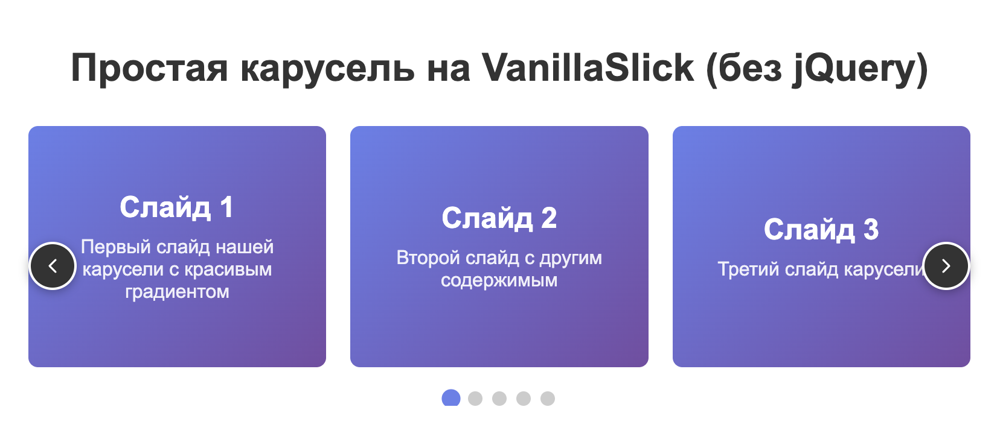

# VanillaSlick 🎠

> Полнофункциональная карусель на чистом JavaScript без зависимостей

VanillaSlick - это мощная и легковесная библиотека карусели, созданная на чистом JavaScript как полная замена Slick Carousel без необходимости подключения jQuery.



Демонстрация VanillaSlick карусели с 3 слайдами, автопрокруткой и навигацией

## ✨ Особенности

- 🚫 **Без зависимостей** - не требует jQuery или других библиотек
- ⚡ **Быстрая и легковесная** - минимальный размер и максимальная производительность
- 📱 **Полностью адаптивная** - поддержка responsive настроек
- 🎯 **Точная навигация** - стрелки и точки навигации
- ♾️ **Бесконечная прокрутка** - seamless infinite loop
- ⏯️ **Автопрокрутка** - с настраиваемыми интервалами
- 🎨 **Полностью кастомизируемая** - легко стилизуется через CSS
- 🧩 **Простое API** - интуитивно понятные методы управления

## 🚀 Быстрый старт

### 1. Подключение файлов

```html
<!DOCTYPE html>
<html>
<head>
    <!-- CSS стили -->
    <link rel="stylesheet" href="js/vanilla-slick.css">
</head>
<body>
    <!-- Ваш HTML контент -->
    
    <!-- JavaScript библиотека -->
    <script src="js/vanilla-slick.js"></script>
</body>
</html>
```

### 2. HTML разметка

```html
<div class="my-carousel">
    <div class="slide">Слайд 1</div>
    <div class="slide">Слайд 2</div>
    <div class="slide">Слайд 3</div>
    <div class="slide">Слайд 4</div>
    <div class="slide">Слайд 5</div>
</div>
```

### 3. Инициализация

```javascript
// Простая инициализация
const carousel = new VanillaSlick('.my-carousel');

// С настройками
const carousel = new VanillaSlick('.my-carousel', {
    slidesToShow: 3,
    slidesToScroll: 1,
    autoplay: true,
    autoplaySpeed: 3000
});
```

## ⚙️ Конфигурация

### Основные параметры

| Параметр | Тип | По умолчанию | Описание |
|----------|-----|--------------|----------|
| `slidesToShow` | `number` | `3` | Количество видимых слайдов одновременно |
| `slidesToScroll` | `number` | `1` | Количество слайдов для прокрутки за раз |
| `infinite` | `boolean` | `true` | Включить бесконечную прокрутку |
| `arrows` | `boolean` | `true` | Показать стрелки навигации |
| `dots` | `boolean` | `true` | Показать точки навигации |
| `autoplay` | `boolean` | `false` | Включить автопрокрутку |
| `autoplaySpeed` | `number` | `3000` | Скорость автопрокрутки в миллисекундах |
| `speed` | `number` | `300` | Скорость анимации перехода в миллисекундах |
| `responsive` | `array` | `[]` | Массив responsive настроек |

### Responsive настройки

```javascript
const carousel = new VanillaSlick('.my-carousel', {
    slidesToShow: 4,
    slidesToScroll: 1,
    responsive: [
        {
            breakpoint: 1024,
            settings: {
                slidesToShow: 3,
                slidesToScroll: 1
            }
        },
        {
            breakpoint: 768,
            settings: {
                slidesToShow: 2,
                slidesToScroll: 1
            }
        },
        {
            breakpoint: 480,
            settings: {
                slidesToShow: 1,
                slidesToScroll: 1,
                arrows: false
            }
        }
    ]
});
```

## 🎮 API методы

### Навигация

```javascript
// Переход к следующему слайду
carousel.next();

// Переход к предыдущему слайду
carousel.prev();

// Переход к конкретному слайду (индекс начинается с 0)
carousel.goToSlide(2);
```

### Автопрокрутка

```javascript
// Запустить автопрокрутку
carousel.startAutoplay();

// Приостановить автопрокрутку
carousel.pauseAutoplay();
```

### Управление жизненным циклом

```javascript
// Обновить карусель (пересчитать размеры и настройки)
carousel.refresh();

// Полностью уничтожить карусель
carousel.destroy();
```

## 🎨 Стилизация

### Основные CSS классы

```css
/* Контейнер карусели */
.vanilla-slick {
    /* Ваши стили */
}

/* Трек со слайдами */
.vanilla-slick-track {
    /* Ваши стили */
}

/* Отдельный слайд */
.vanilla-slick-slide {
    /* Ваши стили */
}

/* Стрелки навигации */
.vanilla-slick-arrow {
    /* Общие стили для стрелок */
}

.vanilla-slick-prev {
    /* Стили для стрелки "назад" */
}

.vanilla-slick-next {
    /* Стили для стрелки "вперед" */
}

/* Точки навигации */
.vanilla-slick-dots {
    /* Контейнер точек */
}

.vanilla-slick-dots li {
    /* Отдельная точка */
}

.vanilla-slick-dots li.vanilla-slick-active {
    /* Активная точка */
}
```

### Пример кастомизации

```css
/* Кастомные стрелки */
.vanilla-slick-arrow {
    background: linear-gradient(45deg, #667eea, #764ba2);
    border: none;
    border-radius: 50%;
    width: 50px;
    height: 50px;
    cursor: pointer;
    transition: all 0.3s ease;
    box-shadow: 0 2px 10px rgba(0, 0, 0, 0.2);
}

.vanilla-slick-arrow:hover {
    transform: translateY(-50%) scale(1.1);
    box-shadow: 0 4px 15px rgba(102, 126, 234, 0.4);
}

.vanilla-slick-arrow svg {
    color: white;
    filter: drop-shadow(0 1px 2px rgba(0, 0, 0, 0.3));
}

/* Кастомные точки */
.vanilla-slick-dots li button {
    background: #ddd;
    border: none;
    border-radius: 50%;
    width: 15px;
    height: 15px;
    margin: 0 5px;
    transition: all 0.3s ease;
}

.vanilla-slick-dots li.vanilla-slick-active button {
    background: #667eea;
    transform: scale(1.3);
}
```

## 📱 Responsive дизайн

VanillaSlick автоматически адаптируется под разные размеры экранов:

```javascript
const carousel = new VanillaSlick('.carousel', {
    slidesToShow: 4,
    slidesToScroll: 2,
    responsive: [
        {
            breakpoint: 1200, // При ширине экрана <= 1200px
            settings: {
                slidesToShow: 3,
                slidesToScroll: 1
            }
        },
        {
            breakpoint: 992, // При ширине экрана <= 992px
            settings: {
                slidesToShow: 2,
                slidesToScroll: 1
            }
        },
        {
            breakpoint: 768, // При ширине экрана <= 768px
            settings: {
                slidesToShow: 1,
                slidesToScroll: 1,
                arrows: false, // Скрыть стрелки на мобильных
                dots: true
            }
        }
    ]
});
```

## 🔧 Расширенные примеры

### Карусель с автопрокруткой

```javascript
const autoCarousel = new VanillaSlick('.auto-carousel', {
    slidesToShow: 3,
    slidesToScroll: 1,
    autoplay: true,
    autoplaySpeed: 2000,
    infinite: true,
    arrows: true,
    dots: true
});
```

### Карусель без бесконечной прокрутки

```javascript
const finiteCarousel = new VanillaSlick('.finite-carousel', {
    slidesToShow: 2,
    slidesToScroll: 1,
    infinite: false, // Отключить бесконечную прокрутку
    arrows: true,
    dots: false
});
```

### Мобильная карусель

```javascript
const mobileCarousel = new VanillaSlick('.mobile-carousel', {
    slidesToShow: 1,
    slidesToScroll: 1,
    arrows: false,
    dots: true,
    autoplay: true,
    autoplaySpeed: 4000,
    speed: 500
});
```

### Карусель с кастомной скоростью

```javascript
const slowCarousel = new VanillaSlick('.slow-carousel', {
    slidesToShow: 3,
    slidesToScroll: 1,
    speed: 800, // Медленная анимация
    autoplay: true,
    autoplaySpeed: 5000 // Долгие паузы
});
```

## 🌐 Совместимость с браузерами

- ✅ Chrome 60+
- ✅ Firefox 55+
- ✅ Safari 12+
- ✅ Edge 79+
- ✅ Opera 47+

## 📋 Системные требования

- Не требует jQuery или других зависимостей
- Поддерживает ES6+ (можно транспилировать для старых браузеров)
- Работает с любыми CSS фреймворками

## 🔍 Отладка

Для отладки можно использовать встроенные методы:

```javascript
// Включить логирование
const carousel = new VanillaSlick('.carousel', {
    // настройки
});

// Получить текущий слайд
console.log('Текущий слайд:', carousel.currentSlide);

// Получить общее количество слайдов
console.log('Всего слайдов:', carousel.slideCount);

// Получить настройки
console.log('Настройки:', carousel.settings);
```

## 🚨 Часто встречающиеся проблемы

### Карусель не инициализируется

**Проблема:** Ошибка "Элемент не найден"

**Решение:** Убедитесь, что DOM загружен перед инициализацией:

```javascript
document.addEventListener('DOMContentLoaded', function() {
    const carousel = new VanillaSlick('.carousel');
});
```

### Стили не применяются

**Проблема:** Карусель выглядит неправильно

**Решение:** Проверьте подключение CSS файла:

```html
<link rel="stylesheet" href="path/to/vanilla-slick.css">
```

### Проблемы с адаптивностью

**Проблема:** Responsive настройки не работают

**Решение:** Проверьте порядок breakpoint'ов (от большего к меньшему):

```javascript
responsive: [
    { breakpoint: 1024, settings: { slidesToShow: 3 } },
    { breakpoint: 768, settings: { slidesToShow: 2 } },
    { breakpoint: 480, settings: { slidesToShow: 1 } }
]
```

## 📄 Лицензия

MIT License - используйте свободно в личных и коммерческих проектах.

## 🤝 Поддержка

Если у вас есть вопросы или предложения по улучшению библиотеки, создайте issue или отправьте pull request.

---

**VanillaSlick** - современная альтернатива Slick Carousel для тех, кто ценит производительность и независимость от jQuery! 🚀
